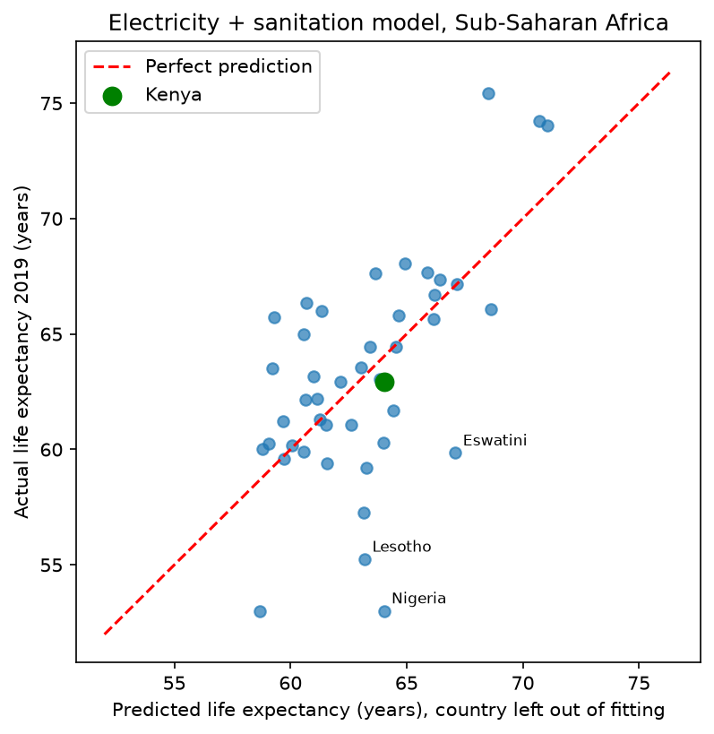

## Data Quality Notes
- Source: World Bank World Development Indicators (CC BY 4.0), year 2019 (chosen to avoid COVID-era distortions).
- Scope: 48 Sub-Saharan Africa countries (World Bank regional grouping).
- Female secondary enrollment was dropped: 29 of 48 countries had no value.
- Eritrea, Equatorial Guinea and South Sudan were dropped for missing values (45 countries remain).
- GDP per capita is highly skewed, so its natural log is used.
- The Central African Republic reports a life expectancy of 31.5 years in 2019, far below neighbours and its own values in other years. It is kept in the data, and models are checked with and without it.

# What goes with longer lives in Sub-Saharan Africa? A linear regression study

Linear regression analysis of life expectancy across Sub-Saharan African countries (2019, World Bank data), asking which country-level factors go with longer lives and where Kenya stands.

## Key findings
- Access to basic sanitation and electricity predicts life expectancy better than income does. A model using only these two cuts the typical prediction error from about 4.7 years (always guessing the average) to about 3.7 years (leave-one-out).
- Each additional percentage point of population with basic sanitation goes with about 0.10 more years of life expectancy (95% interval 0.02 to 0.17). For electricity the estimate is 0.06 years (interval -0.01 to 0.12), so the evidence is weaker.
- Adding GDP per capita to these two services did not improve out-of-sample predictions.
- Kenya's 2019 life expectancy was 62.9 years; the model predicted 64.1 (95% prediction range 56.4 to 71.7). Kenya is a typical case for its service levels.
- Large unexplained gaps remain, for example Nigeria, Lesotho and Eswatini live much shorter than the model predicts. These indicators cannot tell us why.

## Question and approach (CRISP-DM)
1. **Business understanding:** which country-level factors are associated with life expectancy, and does Kenya do better or worse than its services predict?
2. **Data understanding:** World Bank World Development Indicators, 2019 (chosen to avoid COVID-era distortions), 48 Sub-Saharan Africa countries.
3. **Data preparation:** see notebook 02 and the data notes below.
4. **Modeling:** OLS regression with statsmodels for interpretation; VIF, Cook's distance and residual checks; repeated 5-fold and leave-one-out cross-validation; Ridge and Lasso compared.
5. **Evaluation:** models compared by out-of-sample RMSE, not only in-sample R-squared.

## Data notes
- Source: World Bank, World Development Indicators (licence CC BY 4.0), downloaded through the World Bank API (`src/download_wdi.py`). Country regions come from the World Bank country metadata file.
- Female secondary enrollment was dropped: 29 of 48 countries had no value.
- Eritrea, Equatorial Guinea and South Sudan were dropped for missing values (45 countries remain).
- GDP per capita is highly skewed, so its natural log was used in exploratory models.
- The Central African Republic reports a life expectancy of 31.5 years in 2019, far below its neighbours and its own values in other years. It has a Cook's distance about eight times the usual threshold. It was kept in exploratory analysis and excluded from the final fit (44 countries); the final coefficients change little when it is included.

## Limitations
- Association, not causation: these results do not show that sanitation or electricity cause longer lives.
- Country averages only: they say nothing about individuals within a country.
- One year and 44 countries, so estimates are imprecise and prediction ranges are wide (about plus or minus 7.7 years).
- The final predictors were chosen after exploring the data, so the reported errors are slightly optimistic.
- World Bank life expectancy values are modelled estimates and can be uncertain, especially in countries affected by conflict.

## Reproduce
    python -m venv .venv
    source .venv/Scripts/activate     # Git Bash on Windows; use .venv/bin/activate on macOS/Linux
    pip install -r requirements.txt
    python src/download_wdi.py
Then run the notebooks in `notebooks/` in order (01 data understanding, 02 data preparation, 03 modeling).

## Credits
Data: World Bank, World Development Indicators, licensed under CC BY 4.0.